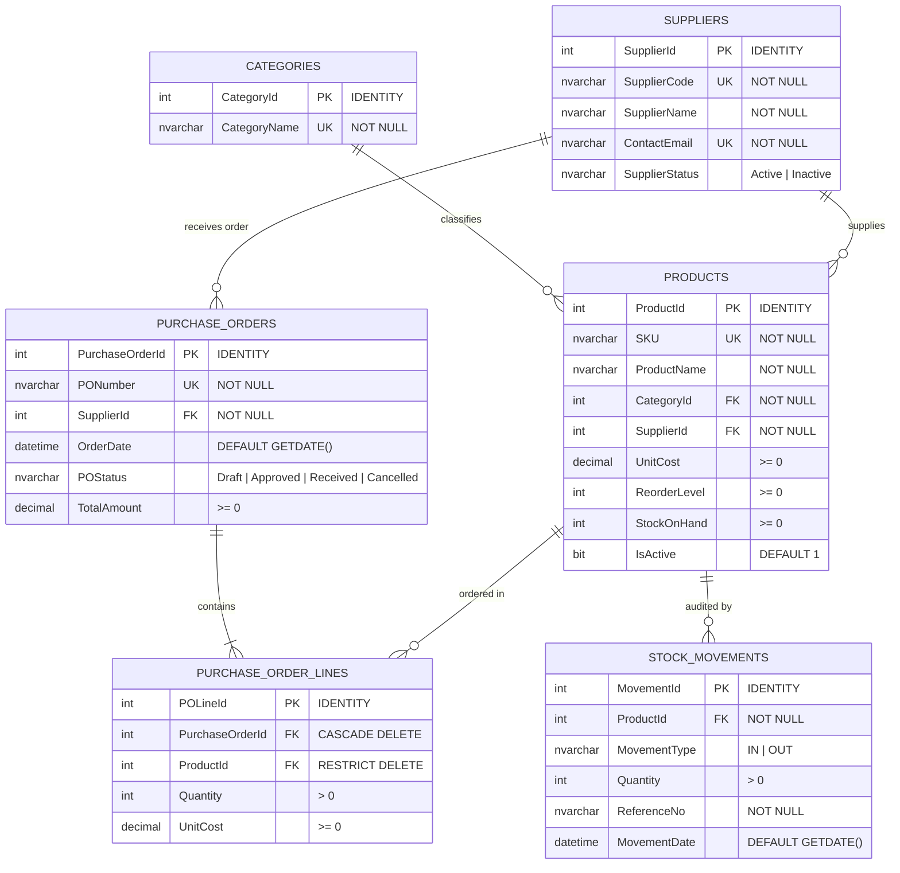
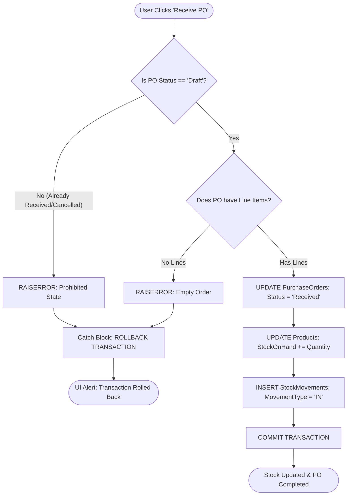

<div align="center">

# 📦 LaurenceGlenn_CRUDV2
### **Enterprise Inventory, Suppliers & Purchase Order Management System**
**Academic Practical Examination Submission — SET D**

[](https://docs.microsoft.com/en-us/dotnet/csharp/)
[](https://dotnet.microsoft.com/)
[](https://docs.microsoft.com/en-us/dotnet/desktop/winforms/)
[](https://www.microsoft.com/en-us/sql-server/)
[-blue?style=for-the-badge)](https://learn.microsoft.com/en-us/dotnet/framework/data/adonet/sql/linq/)
[](https://visualstudio.microsoft.com/)
[](LICENSE)
[](#)

<p align="center">
  <b>A robust desktop enterprise solution featuring 100% pure LINQ to SQL (.dbml) data mapping, relational database integrity with SQL Server, atomic transactions with automatic rollback handling, and a standalone published installer carrying an embedded database.</b>
</p>

[Quick Install](#-quick-installation-published-package) • [Architecture](#-system-architecture--relational-schema) • [Features](#-modules--features) • [Stored Procedures](#-stored-procedures--transaction-reference) • [Exam Defense Guide](#-practical-exam-set-d-defense-guide)

---

</div>

## 📑 Table of Contents
- [Project Overview](#-project-overview)
- [System Architecture & Relational Schema](#-system-architecture--relational-schema)
- [Transaction Integrity & Rollback Flow](#-transaction-integrity--rollback-flow)
- [Modules & Features](#-modules--features)
  - [1. Products Management](#1-products-management)
  - [2. Suppliers Management](#2-suppliers-management)
  - [3. Categories Management](#3-categories-management)
  - [4. Purchase Orders & Line Items](#4-purchase-orders--line-items)
  - [5. Set-Specific Challenge Demonstrations](#5-set-specific-challenge-demonstrations)
  - [6. Reports & Inventory Audit](#6-reports--inventory-audit)
- [Stored Procedures & Transaction Reference](#-stored-procedures--transaction-reference)
- [Tech Stack & Tools](#-tech-stack--tools)
- [Quick Installation (Published Package)](#-quick-installation-published-package)
- [Developer Setup (Visual Studio)](#-developer-setup-visual-studio)
- [Practical Exam SET D Defense Guide](#-practical-exam-set-d-defense-guide)
- [License & Authorship](#-license--authorship)

---

## 📌 Project Overview

**LaurenceGlenn_CRUDV2** is developed as an examination project for **SET D (Inventory, Suppliers, and Purchase Orders)**. 

The application streamlines the procurement lifecycle:
1. **Catalog Management**: Maintains categories and suppliers with strict uniqueness constraints.
2. **Drafting Purchase Orders**: Generates official restocking orders (`Draft` state) linked to specific suppliers.
3. **Itemized Order Lines**: Enforces relational rules, cost checking, and immediate duplicate line rejection.
4. **Atomic Receiving**: Restocks inventory (`MovementType = 'IN'`), updates product `StockOnHand`, logs audit trails, and closes purchase orders within an ACID-compliant SQL Server transaction.
5. **Set-Specific Rollback Verification**: Fully demonstrates transaction rollback under failure conditions (rejecting duplicate product lines and preventing double receiving).

---

## 🏗️ System Architecture & Relational Schema

The relational database (`Bernado`) is normalized and reinforced with primary keys, foreign keys, unique constraints, and check constraints.



---

## ⚡ Transaction Integrity & Rollback Flow

The core procurement procedure `usp_PurchaseOrder_Receive` executes inside an atomic `BEGIN TRANSACTION ... BEGIN TRY ... COMMIT TRANSACTION` block. If any step fails or an invalid state is encountered, an automatic `ROLLBACK TRANSACTION` is executed:



---

## 💻 Modules & Features

### 1. Products Management
* **Full CRUD Operations**: Create, view, edit, and delete products using Visual Studio DataGridView controls.
* **Instant Search Filtering**: Real-time search by **SKU** or **Product Name**.
* **Integrity Validation**: Ensures positive costs, valid reorder levels, and non-negative stock counts.

### 2. Suppliers Management
* **Vendor Directory**: Manage suppliers with individual company codes, names, and verified contact emails.
* **Active Status Toggles**: Enforces soft-disable logic so inactive suppliers cannot receive new purchase orders.

### 3. Categories Management
* **Category Partitioning**: Group products cleanly by department.
* **Unique Constraints**: Prevents duplicate category registration at both UI and database schema levels.

### 4. Purchase Orders & Line Items
* **Draft Workflow**: Initialize new purchase orders linked to active suppliers.
* **Itemized Line Entries**: Add products, quantities, and negotiated unit costs.
* **Live Calculation**: Automatically computes extended totals and aggregate purchase order values.
* **Atomic Receiving**: Executes `usp_PurchaseOrder_Receive` to atomically restock the warehouse.

### 5. Set-Specific Challenge Demonstrations
* **Challenge 1: Duplicate Product Line Rejection**:
  * Attempting to insert a product that already exists on the same draft PO triggers a database validation check.
  * Demonstrates that the transaction cleanly rolls back and leaves existing line items intact.
* **Challenge 2: Double Receive Prohibition**:
  * Attempting to call `usp_PurchaseOrder_Receive` on an order that has already been received is blocked by concurrency locks and status checks.
  * Prohibits double-counting of warehouse inventory and rolls back any unauthorized alterations.

### 6. Reports & Inventory Audit
* **Low Stock Intelligence Report**:
  * Executes `usp_Inventory_LowStockReport`.
  * Computes the inventory **Deficit** (`ReorderLevel - StockOnHand`) and issues automated `REORDER NOW` alerts.
* **Purchase Order Audit Report**:
  * Executes `usp_PurchaseOrder_Report`.
  * Dynamic filtering by PO Status (`Draft`, `Received`, `Cancelled`, or `All`).

---

## 🗄️ Stored Procedures & Transaction Reference

All database operations are encapsulated in Microsoft SQL Server stored procedures:

| Stored Procedure | Parameters | Purpose | Transaction Safety |
| :--- | :--- | :--- | :--- |
| `usp_Product_CRUD` | `@Action`, `@ProductId`, `@SKU`, `@ProductName`, `@CategoryId`, `@SupplierId`, `@UnitCost`, `@ReorderLevel`, `@StockOnHand` | Manages Product INSERT, UPDATE, DELETE, and SELECT operations | Standard DML with Constraint Validation |
| `usp_Product_Search` | `@SearchTerm` | Wildcard search across SKU and Product Name | Read-Only |
| `usp_Supplier_CRUD` | `@Action`, `@SupplierId`, `@SupplierCode`, `@SupplierName`, `@ContactEmail`, `@SupplierStatus` | Supplier lifecycle management | Unique Email & Code Validation |
| `usp_Supplier_GetAll` | *(None)* | Populates supplier dropdowns and data grids | Read-Only |
| `usp_Category_CRUD` | `@Action`, `@CategoryId`, `@CategoryName` | Category lifecycle with unique naming verification | Schema Constraint Checked |
| `usp_PurchaseOrder_CreateDraft` | `@PONumber`, `@SupplierId`, `@NewPurchaseOrderId OUTPUT` | Creates a new PO in `Draft` status | Atomic Insert |
| `usp_PurchaseOrder_AddLine` | `@PurchaseOrderId`, `@ProductId`, `@Quantity`, `@UnitCost` | Adds line items; rejects duplicate products on the same PO | **Atomic with ROLLBACK on Duplicate** |
| `usp_PurchaseOrder_Receive` | `@PurchaseOrderId` | Marks PO as `Received`, increments `StockOnHand`, logs `StockMovements` | **ACID Atomic with ROLLBACK on Error** |
| `usp_Inventory_LowStockReport` | *(None)* | Identifies products at or below `ReorderLevel` | Reporting Query |
| `usp_PurchaseOrder_Report` | `@FilterStatus` | Financial and status reporting of procurement orders | Reporting Query |

---

## 🧰 Tech Stack & Tools

* **Programming Language**: C# 7.3 / .NET Framework 4.7.2
* **Desktop Framework**: Windows Forms (WinForms) with native Visual Studio Toolbox controls
* **Object-Relational Mapping (ORM)**: LINQ to SQL (`.dbml` / `BernadoDataContext`)
* **Database Engine**: Microsoft SQL Server Express 2022 / 2025 (`.\SQLEXPRESS`) & LocalDB (`(LocalDB)\MSSQLLocalDB`)
* **Integrated Development Environment**: Microsoft Visual Studio 2022 (Community / Professional)
* **Packaging & Deployment**: ClickOnce Application Publish (`setup.exe`)

---

## 🚀 Quick Installation (Published Package)

*No Visual Studio compilation or database configuration is required.*

1. **Download or Clone** this repository:
   ```bash
   git clone https://github.com/rnznly/LaurenceGlenn_CRUDV2.git
   ```
2. Navigate to the **`Published_Installer`** directory:
   ```text
   LaurenceGlenn_CRUDV2/Published_Installer/
   ```
3. Run **`setup.exe`**:
   * The ClickOnce installer will install the application and configure the embedded `Bernado.mdf` database automatically.
   * Launch **`LaurenceGlenn_CRUDV2`** directly from the Windows Start Menu or Desktop shortcut!

---

## 💻 Developer Setup (Visual Studio)

To inspect or debug the source code inside Visual Studio 2022:

1. **Open the Solution**:
   * Double-click **`LaurenceGlenn_CRUDV2.sln`**.
2. **Database Engine**:
   * The application includes a self-contained **`Bernado.mdf`** database inside the project.
   * In addition, the complete database creation script is available at [`Bernado_Schema.sql`](LaurenceGlenn_CRUDV2/Bernado_Schema.sql) if you wish to run it against your local `.\SQLEXPRESS` instance.
3. **Build & Execute**:
   * Press **F5** or click **▶ Start** in Visual Studio.
   * `BernadoDataContext.cs` features smart multi-target connection fallback:
     1. Automatically attempts connection to the embedded `Bernado.mdf` via `(LocalDB)\MSSQLLocalDB`.
     2. Falls back to local `.\SQLEXPRESS` instance (`Initial Catalog=Bernado`).

---

## 🎓 Practical Exam SET D Defense Guide

Use these talking points during evaluation or defense:

### Q1: Why does receiving a Purchase Order increase stock instead of reducing it?
> *"In supply chain and inventory accounting, our company is purchasing items from external **Suppliers** to replenish our warehouse. Therefore, when goods arrive and the Purchase Order is received, stock enters the warehouse (`MovementType = 'IN'`), which mathematically increases `StockOnHand = StockOnHand + Quantity`. Inventory is only reduced during Customer Sales (Sales Orders / POS), which is outside the procurement scope of SET D."*

### Q2: How does the application prevent duplicate items on a Purchase Order?
> *"`usp_PurchaseOrder_AddLine` uses an explicit `IF EXISTS` verification query against `PurchaseOrderLines` for the combination of `@PurchaseOrderId` and `@ProductId`. If a duplicate is detected, it raises a severity 16 error and triggers an immediate `ROLLBACK TRANSACTION`, guaranteeing that no duplicate lines are written."*

### Q3: How is atomic receiving enforced?
> *"`usp_PurchaseOrder_Receive` wraps all three operations—updating `PurchaseOrders` status to `Received`, incrementing `Products.StockOnHand`, and inserting an audit record into `StockMovements`—within a single database transaction. If any part of the operation fails, the `CATCH` block invokes `ROLLBACK TRANSACTION` so that inventory numbers are never corrupted."*

### Q4: Why use LINQ to SQL instead of manual ADO.NET?
> *"LINQ to SQL (`.dbml`) provides compile-time type safety, strong object mapping, and eliminates manual SQL string concatenation, preventing SQL injection while maintaining native performance through generated stored procedure method wrappers (`db.usp_PurchaseOrder_Receive(...)`)."*

---

## 📄 License & Authorship

Distributed under the **MIT License**. See [`LICENSE`](LICENSE) for complete terms.

* **Author / Student**: Reenznly and SinceYesterday DevWorks-R000 
* **GitHub Profile**: [@rnznly](https://github.com/rnznly)  
* **Project Repository**: [https://github.com/rnznly/LaurenceGlenn_CRUDV2](https://github.com/rnznly/LaurenceGlenn_CRUDV2)
